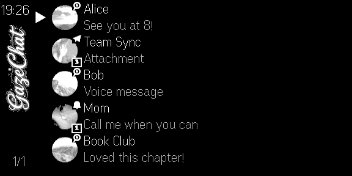
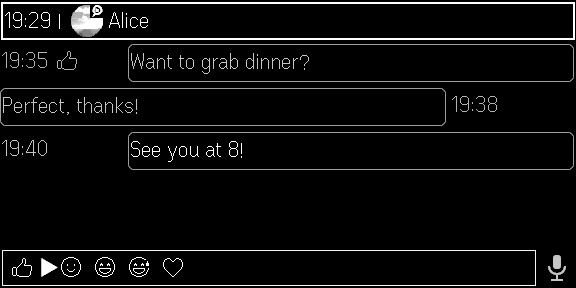
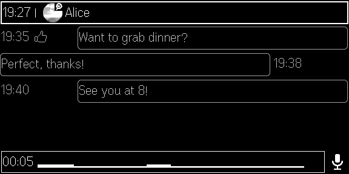
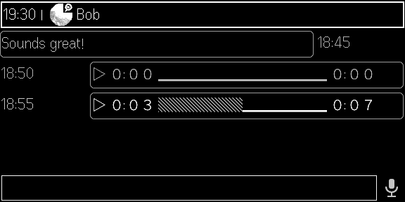
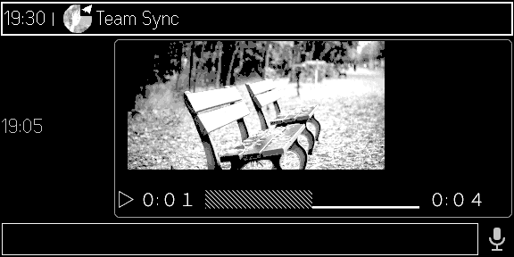
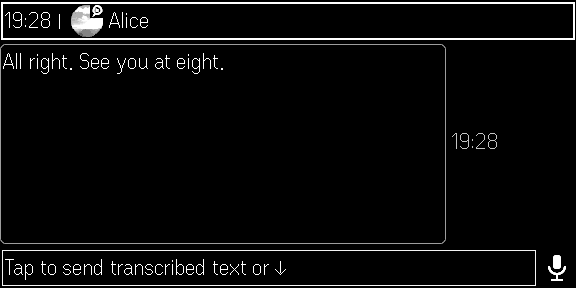
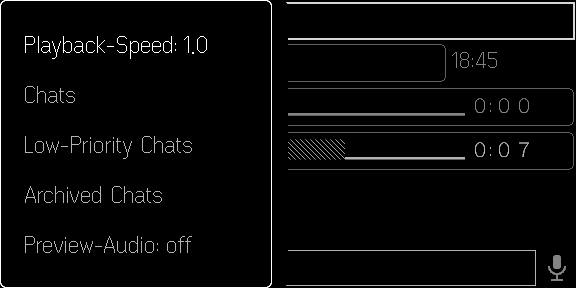

# GazeChat

<p align="center">
  
  
</p>

<p align="center">
  The most feature-complete messenger on Even G2 — WhatsApp, Telegram, Signal, iMessage, Messenger, Instagram, Discord, Slack and every other Beeper network, through a Beeper gateway you set up yourself.
</p>

<p align="center">
  
</p>

## Screenshots

<table>
  <tr>
    <td></td>
    <td></td>
  </tr>
  <tr>
    <td></td>
    <td></td>
  </tr>
  <tr>
    <td></td>
    <td></td>
  </tr>
  <tr>
    <td></td>
    <td></td>
  </tr>
</table>

---

## Features

**Messaging**
- Unified inbox across all Beeper networks (no per-messenger sub-views)
- Read chats on the glasses; reply by typing on your phone (the compose box mirrors to the glasses live) or by voice
- Draft sync: unfinished text carries over between phone and glasses
- Send real WhatsApp-style voice notes (recorded on the glasses mic, encoded OGG/Opus on the phone)
- Reactions via long-press (add and remove your own)
- Group chats show the sender ("Name wrote:")
- Reaction markers, date tags (Mon / 22.10. / 22.10.25), unread badges, low-priority and archived filters, lazy paging for large chat lists

**Media on the glasses**
- Photo previews filling the message area (landscape photos use the full height, split across two containers)
- Video preview: tap a focused video to play a grayscale preview loop with a playback bar (play/pause/restart)
- Voice-note playback: tap a focused voice message to play/pause/replay, playback bar with position
- Playback speed 0.5×–2.0× via the glasses menu (applies live, survives restarts)
- Optional preview audio for media playback on your phone (menu toggle)

**Speech-to-text (optional)**
- Dictate a reply, transcribe it on a local or self-hosted OpenAI-compatible endpoint (`POST /v1/audio/transcriptions`), review the text, then send as text or as the original voice note

**Interaction model**
- Scroll moves a brightness focus across messages and the mic icon; long messages page block by block (X/Y indicator)
- Tap selects; double-tap goes back (and cancels recording/transcription one step at a time)
- Long-press opens the reaction picker in the input bar

## Requirements

- [Beeper Desktop](https://www.beeper.com/) running on your computer
- Even G2 glasses with the Even Realities app (works in the [Even Hub simulator](https://hub.evenrealities.com) too)
- Node.js 18+ (to build)
- Optional: an OpenAI-compatible speech-to-text endpoint for transcription

## Setup

### 1. Beeper Desktop API

1. Beeper Desktop → **Settings → Integrations**
2. Under **Beeper Desktop API**, enable **Allow connections**
3. **Approved connections → +** to create a token. Enable **Allow sensitive actions** only if you want GazeChat to send messages (replies, reactions, voice notes)
4. Copy the token

### 2. Connect GazeChat to Beeper

- **Same machine / LAN:** Base URL `http://<computer>:23373`
- **Remote (phone away from home):** expose Beeper Desktop through a reverse proxy or VPN you control — see [docs/TAILSCALE_SETUP.md](docs/TAILSCALE_SETUP.md) for one proven approach. Whatever you expose, make sure it requires the Bearer token (HTTPS recommended).

### 3. First run

Open GazeChat on the glasses (or the phone view), go to **Settings**, enter the Base URL and token, then **Test & Save**. Speech-to-text is configured the same way (URL, token, model) and can be left empty — voice notes then send without transcription.

## Controls

| Gesture | Chat list | In a chat |
|---------|-----------|-----------|
| Scroll | Move cursor / change page | Move focus across messages, page long messages |
| Tap | Open chat | Play/pause focused video or voice note; confirm recorder choice |
| Tap the mic | — | Start voice recording (tap again to stop, then choose send-as-voice or transcribe) |
| Long-press | — | Reaction picker (or "remove my reaction") |
| Double-tap | Exit app (root) | Back one level / cancel recording |
| Glasses menu | Filters (low-priority, archived) | Playback speed, preview audio, filters |

Typing: focus the input field and type on your phone — text mirrors to the glasses live.

## Development

```bash
npm install
npm run dev        # dev server (http://localhost:5173) — point the simulator or glasses QR at it
npm run build      # production build into dist/
npm run pack       # build + pack messages.ehpk via evenhub CLI
```

Architecture: React app with a headless glasses controller (`src/glasses/GlassesUI.tsx`) that renders the 576×288 display through the Even Hub SDK container model; media engines for photo/video/voice live in `src/glasses/*.ts`; the Beeper client is `src/services/beeperClient.ts`.

## Privacy

GazeChat talks only to your own Beeper Desktop (directly or through your own gateway) and, if configured, your own speech-to-text endpoint. No data passes through any third-party server.

## Credits

Fork of [even-messages](https://github.com/thibautrey/even-messages) by Thibaut Rey, heavily reworked (focus system, media previews, voice notes, reactions, drafts, paging). Thanks to Even Realities for the G2 platform and to Beeper for the Desktop API.

## License

Upstream even-messages is MIT-licensed; this fork is published under the same terms. See [LICENSE](LICENSE).
